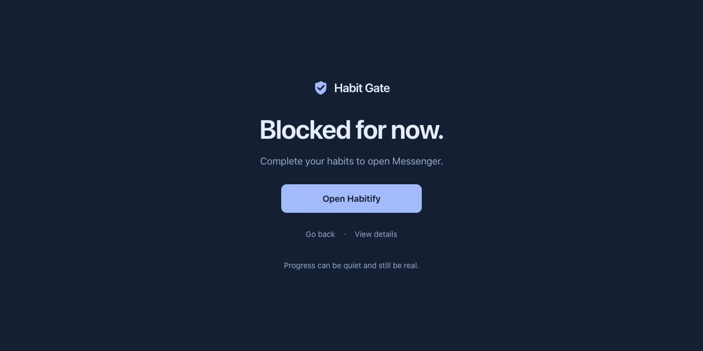

# Habit Gate for Mac

A native SwiftUI menu-bar app plus a Chrome Manifest V3 extension. Your selected websites and Mac apps remain gated until all selected daily Habitify habits due on the active habit date are complete. A shared daily foreground-use allowance provides brief access to blocked Mac apps; websites keep their normal habit rules.

**Current alpha: macOS 1.5.0 (16), Chrome extension 1.1.1.** The [daily allowance specification](docs/DAILY-ACCESS.md) describes this version. The [earlier implementation review](docs/UI-UX-REVIEW.md) records previous UI and reliability work. `VALIDATION.md` is a chronological record; its older version sections describe historical builds.



## Daily app allowance · 1.5.0

Open **Temporary access** in the sidebar to configure a daily allowance. The default is **15 minutes total per habit day**, shared by all configured blocked Mac apps. Opening one of those apps uses the balance automatically. Switching to another app pauses the timer; switching between protected apps continues using the same balance. There is no Start button, extension button or unlimited session restart.

Only foreground use while habits are incomplete counts. Sleep and screen lock pause tracking. When the balance reaches zero, the normal guard hides protected app windows without terminating their processes; calls and uploads may continue in the background. Complete your habits for ordinary access. Chrome does not receive the allowance and stays blocked according to Habitify.

The balance resets at **4 AM**. Choose 5, 15, 30, 60 or custom 1–120 whole minutes in Settings. Changes apply at the next 4 AM reset and never refill the current day's balance. Time already used is retained across app switches and restarts. See [feature specification, flow and validation](docs/DAILY-ACCESS.md).

## Repository and review documents

This public repository contains the Swift app and bridge, Chrome extension, automated tests, design history and engineering evidence. The app remains a personal alpha; publishing its source does not constitute a production release. An open-source license has not yet been assigned. Build instructions below create an ad-hoc signed local app; this repository does not provide a notarized installer.

- [Product and engineering baseline](docs/reviews/HabitGate-Engineering-Review.pdf), with [Overleaf sources](docs/reviews/HabitGate-Engineering-Review-Overleaf.zip): historical native 1.3.0 review.
- [UI/UX and reliability addendum](docs/reviews/HabitGate-UX-Reliability-Review.pdf), with [Overleaf sources](docs/reviews/HabitGate-UX-Reliability-Review-Overleaf.zip): native 1.4.0 / extension 1.1.1 review, before the final Midnight Blue presentation update.
- [Current UI/UX implementation review](docs/UI-UX-REVIEW.md) and [latest presentation evidence](validation/midnight-blue-ui.json).

Review records and screenshots reflect private testing on the author's Mac. Versioned evidence is not a fresh check on another machine. Local API keys, runtime settings, build caches and installed binaries are excluded from Git.

## Start

The built app is in `dist/Habit Gate.app`. `scripts/install.sh` installs it in `/Applications/Habit Gate.app`, registers the per-user Chrome native messaging host, and copies the extension into:

`~/Library/Application Support/HabitGate/ChromeExtension`

1. In **Habitify on your phone**, open **Settings → API Credentials** to obtain a key. API key management is mobile-only; the Mac and web apps do not expose it. Use an existing saved key if available; generating a new key revokes the previous one, and the new key is shown only once. See [Habitify's official instructions](https://intercom.help/habitify-app/en/articles/6113937-use-habitify-api-v2). In **Habit Gate → Connection** on this Mac, paste the key into the secure field and choose **Verify & save in Keychain**. Do not send the key through chat. API access requires a paid Habitify plan. The app verifies both the habit list and dated journal before saving the key.
2. Use **Essential habits** to choose your daily essentials and **Websites** to edit domains. Choose optional **Mac apps** before activation. Start with 2–4 habits. Weekly/monthly goals, bad habits, and unsupported end conditions are excluded. These are setup choices until you review and activate them.
3. In Chrome, manually open `chrome://extensions`, enable Developer mode, select **Load unpacked**, and choose the folder above. Install it in each profile you want to protect. The fixed extension ID is `gggclbgihkhajpchlbeakabkoaaelpdb`.
4. Open the extension once. It should show a working native connection. Grant permissions for any custom website domains. Return to **Overview → Review & activate** after the app receives a fresh report for your exact website list, with permission and rules checks ready. Review the essentials, websites, apps, 4 AM date rule and coverage before activating. The extension's live **Test protection** check runs after activation while access is locked; the preactivation check verifies configuration and permission readiness. Private browsing is covered only if you enable **Allow in Incognito** in the extension details.
5. Complete habits in Habitify. Cloud updates are read every minute while the Mac is awake. **Sync now** requests an immediate check, subject to error backoff.
6. In **Mac apps**, choose installed apps or use **Add app…**, then **Save apps**. Newly added apps join today’s protection immediately. Removals stay protected until the next 4 AM boundary. Website additions use the same timing; Chrome normally picks up the new native policy within 30 seconds, with custom-domain permission required. Habitify, Habit Gate, Finder and essential system controls cannot be selected.

Safari is not installed or protected in this release. There is no Apple signing identity or full Xcode installation available on this Mac. Safari packaging is the next phase, not part of the installed Chrome coverage.

## Daily behavior

- A habit day runs from **4 AM to 4 AM in the Mac's local timezone**. Between midnight and 4 AM, the previous calendar date is used in the Habitify journal query. Enter late-night check-ins on that previous date in Habitify. The app always shows the queried date; Habitify itself resets at midnight.
- Only Habitify's `completed` status counts. Partial progress, `skipped`, `failed`, missing journal entries, and unknown statuses remain blocked. A successfully fetched undo re-locks access.
- Repeat schedules support daily, selected weekdays (Sunday = 0), selected month dates, and intervals from the habit start date. A verified rest day unlocks automatically. Selected habits that go missing, are archived, end, or become unsupported cause a configuration warning and remain blocked.
- The first activation is immediate. After activation, **habit changes wait until the next 4 AM**. **Website/app additions apply when saved**, using today’s existing habit proof. **Website/app removals wait until the next 4 AM**, including a target added earlier that same day. A mixed save adds new targets now while retaining removed targets until the boundary. A timezone change rebases the remaining pending changes. Existing pending target additions are promoted automatically on update.
- If Habitify or the native bridge becomes unavailable, already verified completion remains usable only until its original 4 AM expiry. Unverified states remain blocked. Rate limiting and connectivity errors use 1, 2, 5, then 15-minute retry delays, respecting a longer server Retry-After.
- A browser extension is voluntary enforcement: another unconfigured browser/profile, disabling permissions, or removing the extension can bypass it. The app reports connected profiles, not whole-Mac website coverage.
- Mac app protection is a voluntary foreground guard. While locked, selected apps' windows are hidden when they come forward, and a native notice shows the remaining habits. Already open selected apps are also hidden when access re-locks. Apps are not forcibly quit: drafts, chats, games and background activity can continue. This does not deny process execution, notifications, or background network access, and quitting Habit Gate bypasses it. If macOS refuses a hide request, the app reports that protection needs attention. On verified completion, the selected app can be opened normally or through **Continue** in the notice.

## Architecture and privacy

`GateCore` contains the date and schedule policy, pending settings, domain rules, and atomic persistence. The SwiftUI app owns Habitify calls and Keychain. `HabitGateBridge` uses length-prefixed Chrome native messaging and checks the fixed extension origin. The browser receives an expiring `GateSnapshot`, not credentials.

The API client performs GET requests only against `api.habitify.me/v2`. Redirects are rejected to avoid forwarding the key. Server bodies and request headers are excluded from displayed errors. Local settings and snapshots use owner-only file permissions. Browsing history is not collected. The blocked page retains only the requested website's origin, dropping its path, query and fragment. Continue revalidates access and the configured destination before navigating to that site's root.

Chrome uses declarative navigation redirects, first-party resource blocking, and selected-site document-start guards for existing pages, cached pages, focus, and expiry. Dynamic rules replace the installation defaults; removing a website in tomorrow's policy therefore takes effect correctly.

Mac app protection uses `NSWorkspace` application events and `NSRunningApplication.hide()`. The existing five-second housekeeping timer checks the foreground app and reset state; no fast process polling, Accessibility access, root daemon, or forced termination is used. The local cached snapshot includes selected app names and bundle identifiers for recovery, and that metadata is also present in bridge responses. Browser enforcement uses the website list; it never receives the API key. Existing website-only policies migrate with an empty app selection.

Closed native panels release their SwiftUI views. The Today panel displays the last successful sync time without a continuously updating relative-time clock, keeping the menu-bar app quiet while its panels are closed.

## Build and test

Requires macOS 13+, Apple Silicon for the supplied binary, Swift Command Line Tools, and Node.js for extension tests. No external Swift packages or npm dependencies.

```sh
./scripts/test.sh
./scripts/build.sh
./scripts/install.sh
```

The test script explicitly loads the bundled Swift Testing macro plugin where needed by the macOS 27 Command Line Tools. Tests require the toolchain's Testing framework. The native UI explicitly uses SwiftUI's property wrapper to avoid needing the new State macro plugin from full Xcode.

Builds are locally ad-hoc signed and are not notarized distribution builds. Updating an installed app can require Keychain access to be allowed again. Quit the app before installing an update. Updating unpacked extension files requires choosing Reload in Chrome's extension page.

The app includes a blue shield-and-check icon in every standard macOS size. `Resources/AppIcon.icns` is bundled by the build script. To regenerate it from its native vector drawing source, run `./scripts/build-icon.sh`, then rebuild and install the app. The menu-bar icon stays a system template symbol so it remains readable in light and dark appearances.

## Visuals and validation

`design/` contains the three AI-generated concept boards: Native Quiet, Focus Dark, Paper Study. They use illustrative progress and are design explorations, not proof of a live Habitify connection. Native Quiet guides the implemented interface. `design/prompts.md` records the prompts and tool used.

The current Chrome blocked page implements the user's selected **Midnight Blue** concept: a full-viewport navy surface, compact Habit Gate wordmark, pale periwinkle action, short access message, one utility row and a quiet random focus quote. **View details** opens remaining habits, sync controls, active date/reset and coverage in a keyboard-accessible native dialog using the same palette. The main page fits the tested laptop/desktop viewports without scrolling; long lists scroll inside the optional details dialog. The compact extension popup keeps its existing automatic light/dark style. Assets and system fonts are local. Hidden browser pages stop requesting their UI refresh until visible again; native verification and browser enforcement remain independent.

`design/midnight-blue/` contains current rendered laptop/desktop and details screenshots. The selected generated concept and prompt are in `design/minimal-blocked/alternatives/03-midnight-blue*`; other images document earlier design directions. Previews use current habit names with mock extension messaging; alternate states are illustrative. Frontend files are installed in the existing unpacked extension directory. Refresh an already open blocked page with Command-R after a UI update. Background or manifest changes still require reloading the extension itself.

See `VALIDATION.md` for actual build, tests, installation, browser, API, and performance results. Live API checks require your key and browser activation requires manual loading in Chrome.

## Native app redesign · 1.2.0

The native app follows the built-in imagegen concept in `design/native-redesign/imagegen-concept.png`. Its exact prompt is saved alongside it as `imagegen-prompt.txt`. The concept uses illustrative progress; the installed app reads live Habitify data.

The Today menu-bar panel, main window, connection setup and blocked-app notice share adaptive light/dark colors, a blue shield identity, numbered habit cards, segmented progress, clearer sync status and consistent actions. The main window has Overview, Essential habits, Websites, Mac apps, Connection and Preferences sections. Protection status appears above the full essentials list so a longer habit selection remains easy to scan. Longer lists scroll, and completed, skipped, failed, rest-day and configuration states have explicit text. The 1.2.0 build used system symbols for the Mac app selector; version 1.4.3 restores the installed macOS icons as small thumbnails.

Open **Preferences** for launch at login and the optional unlock notification. Reopening Habit Gate from Applications opens the main window; closing its windows returns it to menu-bar operation. Policy, API access and browser enforcement remain unchanged. macOS may ask to approve access to the saved Keychain item after installing a locally signed update; complete that prompt on your Mac and never send passwords or keys through chat.

`installed-*.png` files in the design folder capture real installed screens; `*-preview.png` files are isolated, illustrative UI fixtures that never read credentials or change saved rules.

## Reliability and idle work · 1.2.1

The menu-bar interface and app guard start before reading Keychain. Credential reads and writes run on a separate actor, so a slow macOS approval cannot freeze the interface or delay the existing app rules. Cached verification keeps its normal daily expiry. Connection settings distinguish a missing key from unavailable Keychain access and provide a retry action; pending reads are coalesced and cannot overwrite a successfully reconnected key.

Unchanged Chrome heartbeat timestamps no longer invalidate the native interface; changes to connected profiles, website permissions and private-browsing coverage still appear. Habit lists are saved and published only when their contents change. The journal is still verified every 60 seconds, and the guard/reset housekeeping interval is unchanged.

## Rule timing · 1.3.0

Habits and target lists now have different save behavior. Essential habits still use **Save habits for next day**. Websites and apps use **Save websites** / **Save apps**: additions take effect now and removals wait until 4 AM. Saving one screen does not commit an unfinished draft on another screen. Notices distinguish saved habit changes from pending website/app removals. Today's completion proof is preserved when only targets change, so adding a target does not re-lock an already verified complete day.

## Clarity and recovery · 1.4.0 / Chrome 1.1.1

Overview separates the access decision, Habitify verification and reported protection coverage. Essentials show named active and scheduled selections. Mac apps distinguish selected/watched apps from windows successfully hidden in this session. The compact extension popup focuses on access and connection; the full remaining-habit list belongs in Today, Overview and blocked surfaces.

Manual sync distinguishes requested, checking, newly verified, failed and previously verified data. A cached reply does not count as a fresh check. Configuration validation and an owner-only recovery copy prevent unreadable rules from appearing as a new installation. Recovery stays locked until the user reviews and restores rules; failed saves retain existing rules. Connection offers Disconnect, Reconnect and confirmed deletion of this app's saved Keychain item.

Chrome 1.1.1 requests only missing domains using explicit HTTP/HTTPS permissions directly from the button click. Permission failures show a relevant recovery action. If Chrome still reports an older version after Reload, check the loaded folder and replace the old unpacked registration. On this Mac, removing the old Habit Gate card and loading the canonical folder again resolved the stale 1.1.0 registration. Fresh 1.1.1 reports confirm all six domains, and live Messenger navigation redirects correctly. Incognito access remains off.

The installed app passed 61 Swift and 20 browser tests. No resource profile was taken for 1.4.0. This remains a private alpha: signed/notarized production installation, the full live acceptance matrix, accessibility testing and an independent onboarding pilot are still required.

## Minimal blocked page and quotes · presentation update

The blocked page now follows the user's simple focus-blocker reference instead of a dashboard. It uses a single centered message and one primary action; detailed status is available on demand. Twelve original encouragement quotes are bundled locally and randomly selected once per document. The quote stays still during the existing state refreshes. There are no additional network requests, quote service, generated raster assets, storage writes or timers for this feature.

The design was generated with built-in imagegen, then implemented in local HTML/CSS with the existing SVG identity. The quote requirement arrived after the concept; current rendered screenshots include it. Native code, daily rules, background enforcement and Chrome permission declarations are unchanged. Twenty browser tests pass, with visual checks of eight viewport sizes from 640×360 to 1920×940, completion/rest/error/permission/long-list fixtures, Escape dismissal and focus return. See `validation/minimal-blocked-ui.json`. The engineering PDFs predate this presentation follow-up; their policy and reliability review remains applicable, while these screenshots show the current blocked UI.

The user subsequently selected **03 · Midnight Blue**. That direction is now implemented with flat native CSS colors, a compact tonal shield/wordmark, a single periwinkle primary button, an inline Go back / View details row, and a non-italic random quote. The details dialog shares the same navy palette. Eight responsive checks, normal/complete/rest/recovery fixtures, Escape/focus behavior and all 20 browser tests passed again. Calculated text contrast ratios range from 6.11:1 to 13.63:1 for the checked pairs; this is not a full accessibility audit. Current evidence is `validation/midnight-blue-ui.json`. Saved policy and Chrome permission declarations are unchanged.

## Stable blocked-app notice · 1.4.1

A launch can generate several macOS activation/unhide events. The guard now combines in-flight hide requests, ignores stale events for an already hidden app and confirms the hide before showing its notice. An already-visible notice updates without repeated activation. Dismissing it still allows a later genuine blocked-app attempt to show the explanation again. Unlocks and removed targets cancel obsolete hide verification.

Hiding starts immediately, confirmation uses the existing 150 ms delay and bounded retries, and the five-second housekeeping interval is unchanged. No bypass or extra periodic timer was added. Four regression cases reproduced duplicate notices/retries before the fix and pass afterward. All **65 Swift and 20 browser tests** pass; installed signature/protocol checks, live Habitify synchronization and a real Discord interception/dismissal were checked. Rules and launch at login were preserved. No new performance profile was taken. See `validation/notice-stability-update.json`.


## Zalo cold-launch notice · 1.4.2

Zalo activates before finishing launch and can bring itself forward several more times as its UI starts. The guard retains the opening attempt, waits for macOS's launch-complete event before hiding, and keeps foreground intent if an activation event arrives during a quiet hide. A single floating notice stays above ordinary startup windows with no opening animation. Existing notices are raised without activating Habit Gate again; **Return to work** dismisses the notice. A later deliberate opening can show a new notice.

A real Zalo cold launch, dismissal, reopen and attempt with a notice already open were checked on the installed build. During the recorded cold-start sequence the same notice kept its window ID and bounds, and Habit Gate activated once. All **67 Swift and 20 browser tests** pass. No additional periodic polling, policy changes, forced app termination or current performance claims were introduced. Zalo's own startup/Dock animations can still occur: this remains a foreground window guard. See `validation/zalo-cold-launch-update.json`.


## Installed Mac app icons · 1.4.3

The Mac app picker now displays the same application icons macOS supplies, including Finder customisation, instead of app-specific substitute symbols. Icons load when each row appears and are rendered into a single 60×60-pixel image for the 30-point row. The view retains that thumbnail, with no persistent icon cache, additional timer or network request. An unavailable application uses a generic app symbol.

The five selected app icons and the missing-app fallback were checked. Each rendered thumbnail has a 14,400-byte pixel buffer; this is a bitmap measurement, not a total-process memory claim. All **67 Swift tests** and installed signature/native-host checks pass, and the installed picker was visually verified. Saved rules are unchanged and live Habitify sync continues. See `validation/native-app-icons-update.json`.


## Saved-key indication · 1.4.4

Connection settings show a fixed row of masked dots in the empty API-key field when a key is connected. The dots are presentation only: the saved credential is not copied into the field, and Verify & save stays disabled until a replacement is entered. Accessible help explains that a key is already saved. Empty Return submissions leave the connection alone.

The installed screen, disabled button, release build and installed signature/native-host checks were verified. Live sync continues, and saved policy—including pending removals—is unchanged. This is a UI-only patch; the native/browser test suites were not rerun for this display change.


## Habitify catalog visibility · 1.4.5

Habitify's catalog includes archived habits. The essential-habit picker now offers active habits with supported daily goals, rather than displaying every API record. Already-selected unavailable habits remain visible with a specific explanation so selections can be repaired; missing selected IDs still appear as configuration problems. The complete API catalog remains available to the policy engine, and filtering never counts a missing or archived habit as complete.

A fresh live sync and the installed eight-row daily picker were verified. All **70 Swift tests** pass, including refreshed API results with deletion/rename/archive changes and unavailable selections that must remain blocked. Existing rules are unchanged. The Chrome extension was unchanged and its tests were not rerun. See `validation/habit-catalog-update.json`.
