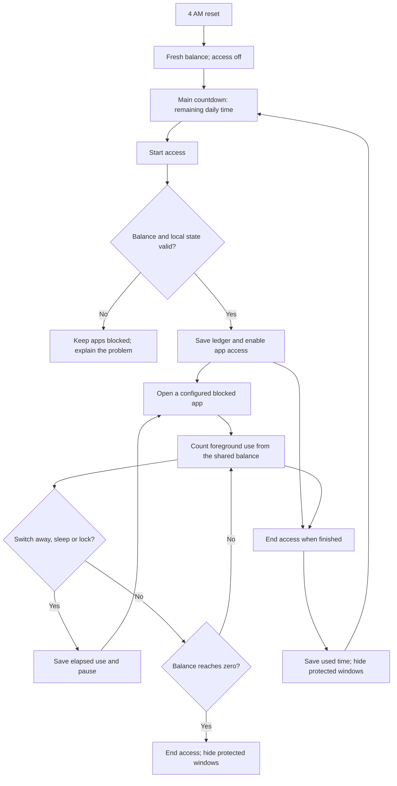
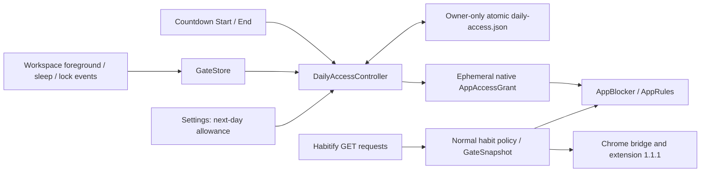
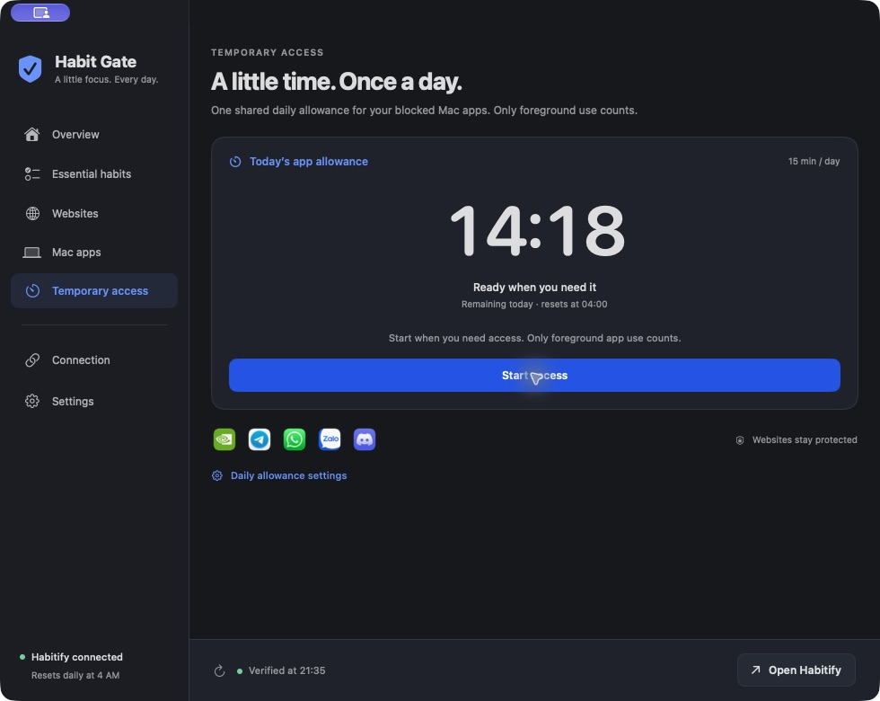
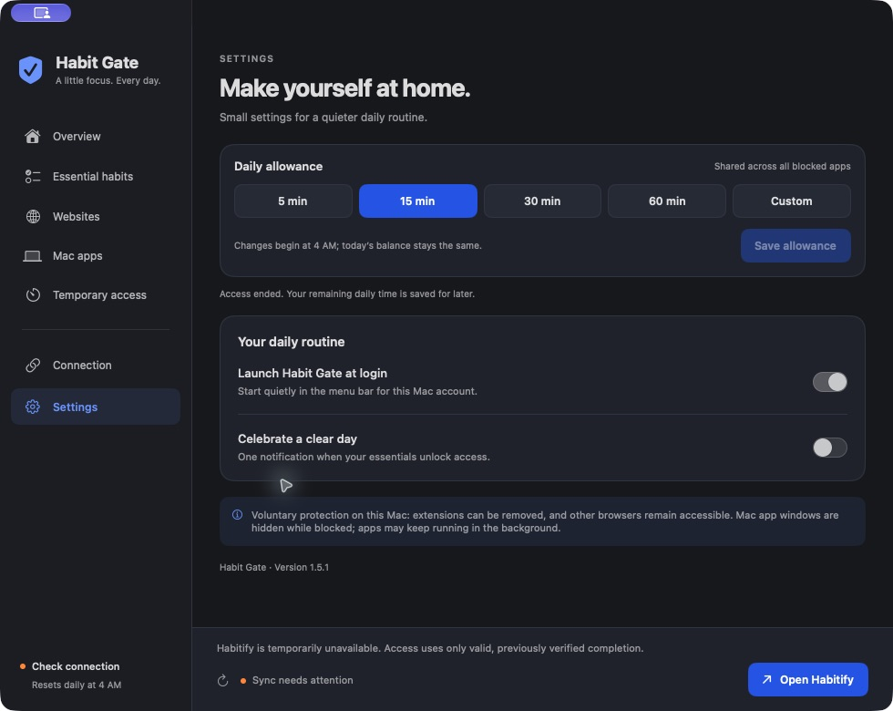

# Daily app access — native 1.5.1

Choose **Start access** when you need a blocked Mac app and **End access** when finished. All configured blocked apps share **15 minutes per habit day** by default. Starting again uses the time left; it never creates another 15 minutes.

The main Temporary access page shows the countdown and the current action. Daily-limit controls live in the **Settings** sidebar tab.

## Feature specification

| ID | Requirement | Behavior |
|---|---|---|
| DA-01 | Shared daily balance | Default 900 seconds across every app in the permanent Mac app policy. No per-app refill or extra-time button. |
| DA-02 | Explicit Start | App windows remain protected until Start succeeds. The local ledger must save before access is granted. |
| DA-03 | Foreground accounting | After Start, count only while a configured app is foreground. Switching away, sleep and screen lock pause usage. |
| DA-04 | Explicit End | Settle and save used time, revoke the grant and immediately recheck running apps. Hide protected windows without terminating their processes. |
| DA-05 | Reuse remaining time | Start and End as needed within the same balance. For example, 3 minutes used leaves 12 minutes for later that day. |
| DA-06 | Exhaustion | At zero, end access automatically. Complete the habits for normal access or wait for the daily reset. |
| DA-07 | Settings | In Settings, choose 5/15/30/60 minutes or a custom integer 1–120. Changes apply at the next 4 AM reset and never refill today. |
| DA-08 | Daily reset | Fresh configured balance at 4 AM; access is off until Start is chosen again. A timezone change does not refill the saved period early. |
| DA-09 | Normal habit unlock | Verified completion ends temporary access and uses ordinary unlocked protection rules. An undone completion requires a new manual Start to use the balance. |
| DA-10 | Restart and recovery | Restart with access off and retain used time. Configuration problems or a detected clock rollback revoke access. Habitify network failure alone does not consume or remove the local balance. |
| DA-11 | Browser isolation | No change to GateSnapshot, Chrome messages, browser permissions, Habitify requests or permanent app selections. Websites receive no temporary grant. |
| DA-12 | Shortcuts | Today has the same Start/End action. A blocked-app shortcut opens the countdown; successful Start opens only the originally requested app once. |

Calls and uploads may continue in the background after End or exhaustion. This is voluntary foreground-window protection, not process termination or background network blocking.

## User flow



Example: Start, use Telegram for two minutes and Zalo for one minute, then End. The countdown has 12 minutes left. Starting later resumes that same 12-minute balance. Time in Finder or another unconfigured app does not reduce it.

## Engineering design



`DailyAccessBudget` persists the configured limit, today's limit, used seconds, habit date, fixed reset deadline, saved time and an optional unfinished foreground segment. The manual `accessStarted` flag is in memory only and defaults to false on launch. End does not reset the ledger.

The file contains no API key, chat contents, browser history or per-app usage history. UTC instants use numeric epoch milliseconds. A unique mode-0600 temporary file is synchronized before an atomic rename. Existing installations initialize a 15-minute ledger. Malformed existing data initializes an exhausted day; missing or changed data detected while running also exhausts the current balance.

Foreground accounting uses `mach_continuous_time`. Transitions save elapsed usage; one scheduled exhaustion action revokes access at the deadline. A running visible countdown can update once per second; a paused countdown has no periodic UI schedule. There are no per-second disk writes or fast process scans. The existing five-second housekeeping pass verifies state and updates whole-minute menu-bar labels.

Workspace transitions are accounted for before enforcement. Initial scans, activation handling and delayed hide verification all consult the same native grant. Start cancels pending hides for exempted apps; End scans running apps immediately. Permanent target and habit rules are unchanged.

Normal sleep and lock events pause accounting. Clean exit settles use; launch always requires Start again. If the guard crashes or is killed during foreground use, the unfinished segment is conservatively charged through restart within that habit day. A new day begins with its configured balance. Manual system-clock manipulation and removal of local files are outside tamper-resistant enforcement.

The saved reset deadline stays fixed during a timezone change. At that deadline, the next period uses the current local 4 AM boundary. This avoids an immediate extra allowance from changing timezones.

## Interface and accessibility

The app opens its countdown page after setup. It shows large monospaced timer digits, a Ready/Counting/Paused/Used-up label, the daily limit and reset time, one Start or End action, and the real icons of protected apps. The settings shortcut opens the Settings tab, where allowance editing sits above login and notification preferences.

The Today panel keeps a compact timer and the same action. The blocked-app notice links to the countdown. Blue actions, adaptive light/dark surfaces, system fonts and explicit text labels follow the existing native design. Settings retain Command-S saving and explicit custom-input labels. No flashing or decorative timer animation is used.

## Validation — 1.5.1, 21 October 2026

**87 Swift tests and 20 Chrome tests passed.** The new manual-flow test verifies that opening an app before Start grants nothing, End preserves remaining time, repeated Start does not refill the balance, and exhaustion prevents another grant. Existing tests cover scope, pause/resume, invalid input, persistence failures, restart, sleep/lock suspension, clock rollback, timezone changes, reset, habit completion and snapshot isolation.

The controlled native fixture was rerun with manual Start. A visible disposable window remained available during a five-second remaining balance, then received exactly one real macOS hide call. Its process survived and repeated refreshes produced no duplicate notice. Foreground signals were simulated so the test did not require controlling the user's desktop focus. Physical clock/sleep changes were modeled rather than applied to this Mac.

On the installed app, Start changed the action to End and enabled access; End returned it to Start with the unused balance unchanged. The countdown's settings shortcut opened Settings, where duration controls were visible. Launch at login remained enabled. Used time and permanent configuration were preserved across installation, and Habitify synced successfully. Chrome remains 1.1.1, with no browser-source or protocol changes.

The main countdown was checked in an 880 × 680 layout fixture. Actual installed screenshots are below. Machine-readable evidence is in `validation/manual-access-1.5.1.json`.

### Installed screenshots



| Access enabled | Settings |
|---|---|
|  |  |

### Performance limits

The earlier 1.5.0 warm closed-window sample measured **0.673% CPU and 108.16 MB mean RSS**, exceeding the original <0.5% / <100 MB targets. See `validation/daily-access-1.5.0.json` for sample conditions and earlier results. This 1.5.1 flow/layout update has not been benchmarked separately; no performance improvement is claimed.

## Rollback

App and private state backups are stored outside the public repository. Run:

```sh
./scripts/rollback-daily-access.sh '/full/path/to/backed-up/Habit Gate.app'
```

The script stops the current app and restores the previous signed app while retaining the daily ledger, permanent rules, Keychain data, login registration and Chrome extension. Keeping the ledger prevents rollback from refilling spent time in an older allowance-capable version. The prior version's own access behavior applies after reopening it from Applications.
