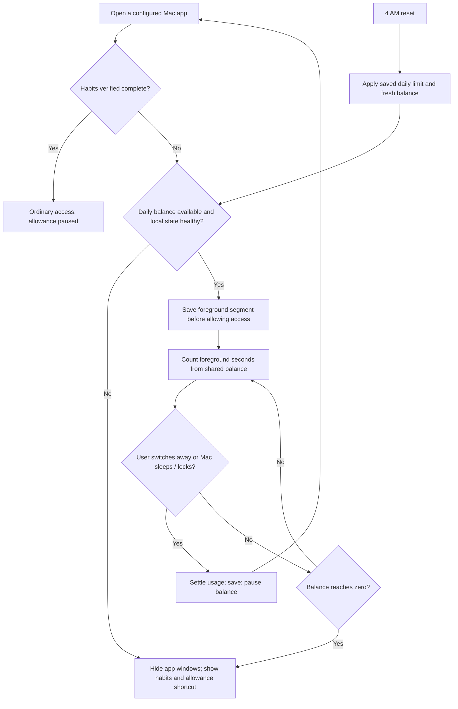
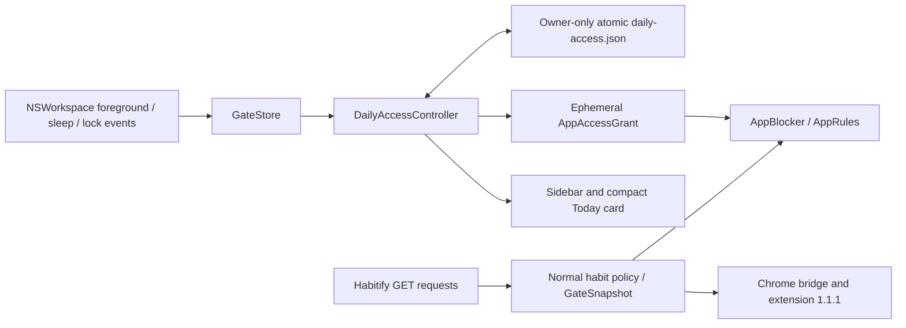
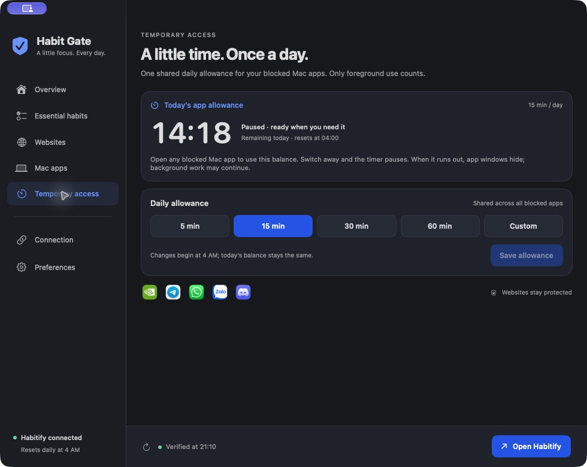
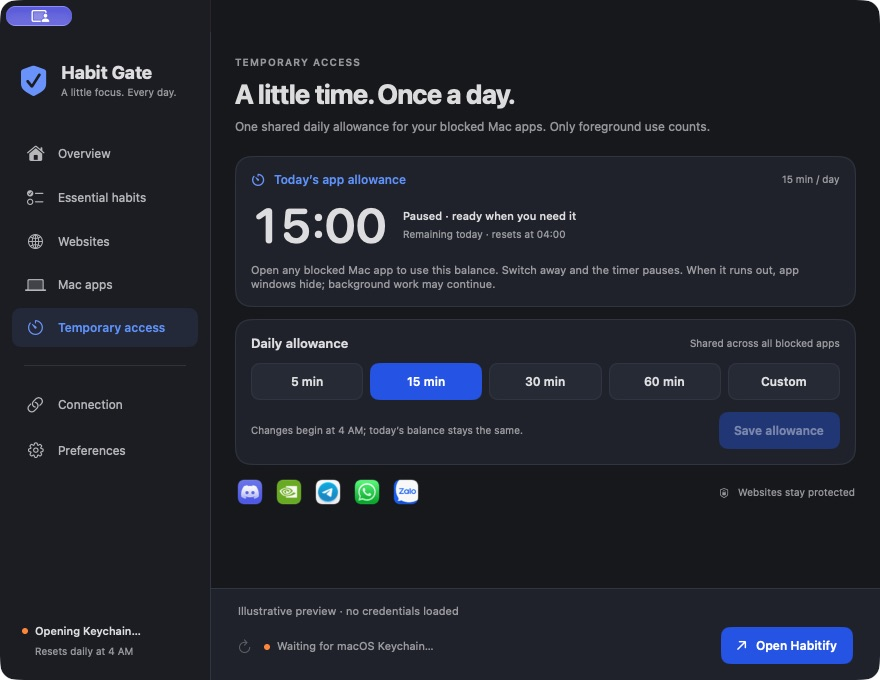
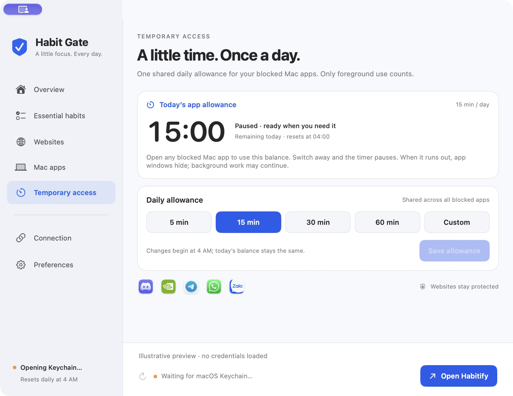

# Daily app allowance — native 1.5.0

**Product rule:** 15 minutes per habit day, shared across configured blocked Mac apps. Count foreground use and pause when the user switches away. Settings control the next day's allowance. Chrome remains governed by habit completion.

## Feature specification

| ID | Requirement | Implemented behavior |
|---|---|---|
| DA-01 | One daily budget | Default 900 seconds across every app in the permanent Mac app policy. Switching apps never refills it. |
| DA-02 | Automatic use | Bringing a protected app forward starts counting if habits are incomplete and balance remains. No session setup is required. |
| DA-03 | Pause | Switching to another app, screen lock or sleep settles the segment and pauses. Background apps do not consume time. |
| DA-04 | Exhaustion | At zero, revoke the native exception and immediately recheck running apps. Hide windows; preserve processes. |
| DA-05 | Settings | Presets 5/15/30/60 minutes or custom integer 1–120. Save changes for the next 4 AM reset; preserve today's used time. |
| DA-06 | Reset | Refill at the existing 4 AM habit-day boundary. Carry no unused time forward. A timezone change does not refill the current saved period early. |
| DA-07 | Habit completion | Verified normal access pauses allowance accounting and uses the ordinary unlocked state. An undone completion resumes the remaining daily balance. |
| DA-08 | Browser isolation | No change to GateSnapshot, native browser messages, Chrome permissions, Habitify requests or permanent selections. |
| DA-09 | Failure | Save before granting foreground access. Unreadable runtime state, a detected clock rollback or storage failure denies the local exception. Habitify network failure alone does not remove the local allowance. |
| DA-10 | Feedback | Remaining MM:SS, counting/paused/used-up labels, daily limit and reset time in the sidebar page and compact Today card. One-minute warning; system notification only with existing authorization. |

All configured blocked Mac apps share the allowance automatically. It applies only to foreground window access. Notifications, uploads and calls can continue in background after exhaustion. This remains voluntary protection: quitting Habit Gate, changing local files or disabling the browser extension can bypass enforcement.

## User flow



Example: two minutes in Telegram, one minute in Zalo and twelve minutes in Discord exhaust a 15-minute allowance. Time in Finder, a meeting in another unconfigured app, or a sleeping Mac does not reduce it. Reopening a protected app uses the same remaining time.

## Engineering design



`DailyAccessBudget` is the persisted ledger: configured limit, today's limit, used seconds, habit date, reset deadline, saved time, and an optional unfinished foreground segment. It contains no API key, chat contents, browser history or per-app usage history. UTC instants are stored as numeric epoch milliseconds. A unique mode-0600 temporary file is written and synchronized before an atomic rename. Existing installations initialize a 15-minute ledger; malformed existing data initializes an exhausted day. Missing or changed data detected while running exhausts the current day's balance.

`DailyAccessController` accounts with `mach_continuous_time`. Workspace events settle and persist transitions; one scheduled exhaustion action revokes access at the deadline. There are no per-second disk writes or fast process scans. A visible running countdown can update once per second; a paused countdown has no periodic UI schedule. The existing five-second housekeeping pass verifies local state and updates whole-minute menu-bar labels.

Foreground transitions are accounted for **before** AppBlocker enforces that event. All initial scans, activation handling and delayed hide verification consult the same optional native grant. Policy additions/removals and habit selection retain their existing rules.

Normal sleep and lock events pause the ledger before time away. A clean app exit settles the segment. If the guard crashes or is killed during foreground use, the persisted unfinished segment is charged conservatively through restart within that habit day; unobserved time may therefore be charged. A new habit day still begins with its configured allowance. This avoids restoring free time by restarting the guard. Manual system clock manipulation and removal of local files are outside tamper-resistant enforcement.

The saved reset deadline stays fixed during a timezone change; when that deadline passes, the next period uses the current local 4 AM boundary. This avoids an immediate extra allowance from switching timezones. Settings display the balance separately from the configured next-day limit.

## Interface and accessibility

The Temporary access sidebar page shows the shared balance first, its paused/counting state, then the daily-limit setting and the real installed icons for the protected apps. There are no Start, End or extra-time actions. The Today panel uses a compact allowance card and habit progress summary to stay short. The blocked-app notice links to the allowance setting when the balance is exhausted.

The interface retains the shield identity, blue actions, system fonts, explicit text states, monospaced timer digits and automatic light/dark colors. Presets and saving are native keyboard-accessible buttons; the custom field has an explicit accessibility label. No flashing or decorative timer animation is used.

Screenshots and measured validation are recorded below and in `validation/daily-access-1.5.0.json`. Preview fixtures contain illustrative balances and do not read credentials or personal habits.

## Rollback

Local app and support-state backups were made outside the public repository before installation. Run:

```sh
./scripts/rollback-daily-access.sh '/full/path/to/backed-up/Habit Gate.app'
```

The script stops Habit Gate, moves its allowance ledger aside and restores the prior signed app. It retains Habitify rules, Keychain data, login registration and the Chrome extension. Open the restored app from Applications. The older app has no daily exception, so ordinary habit protection resumes.

## Validation on 21 October 2026

**86 Swift tests and 20 Chrome tests passed.** Release compilation, installed signature verification, native messaging framing/origin rejection and rollback-script syntax checks passed. The installed signed binary matches `dist`. The original permanent configuration is byte-for-byte unchanged. Launch at login remains enabled. After the user approved the newly signed build's Keychain request, Habitify sync succeeded and the normal website snapshot remained blocked.

Automated coverage includes shared app scope, foreground/pause transitions, switching protected apps without refilling, exact exhaustion, input bounds, failed writes and retry, restart with an unfinished segment, sleep/lock suspension, recovery, offline availability, normal habit unlock, 03:59→04:00, timezone changes, clock rollback, malformed/missing runtime data and absence of per-second writes. Tests also verify that allowance use does not modify permanent rules or GateSnapshot.

The native integration fixture began with a visible disposable app and **five seconds remaining in a one-minute ledger**. A controlled foreground-accounting signal drove the real controller and AppBlocker. The window remained visible during the grant, then received exactly one real macOS hide call at exhaustion. Its process survived, the grant was revoked, and repeated refreshes produced no duplicate notice. This fixture does not inspect chats or alter real Habitify habits. Workspace event ordering is tested separately with fake guarded apps.

In the production app, the 15-minute balance was consumed across app use and then remained paused; reinstall/restart preserved used time. The installed screenshot shows the remaining balance, not a fresh mock timer. Minimum-size light/dark fixtures confirmed all five icons and essential controls fit **880 × 680**. Invalid 0-minute input disables saving; 120 is accepted. Command-S saved a next-day preference in an isolated fixture while today's balance stayed at 15 minutes.

A fresh Chrome report confirmed configured-site permissions and rules ready, with private mode off. A new navigation test could not be inspected because the browser's URL policy rejected the resulting protocol. Blocked-page content was therefore not reverified through automation. Extension source/version, browser messages, GateSnapshot schema and Habitify requests are unchanged.

Physical sleep/lock and clock/timezone changes were modeled rather than interrupting this Mac's work or changing its system clock. A full 15-minute real-app exhaustion run was replaced by the controlled native fixture above.

### Performance evidence

Each sample lasted about 65 seconds and measured native-process CPU and resident memory, excluding the browser. RSS includes shared/reclaimable pages and is not the same as macOS physical footprint.

| State | CPU, average % of one core | Mean RSS |
|---|---:|---:|
| Previous 1.4.5, closed window | 0.229% | 38.98 MB |
| Initial 1.5.0, closed window | 0.337% | 38.71 MB |
| Final build, warm visible window after Keychain approval | 0.933% | 120.16 MB |
| Final build, warm closed window | 0.673% | 108.16 MB |

**The original <0.5% idle CPU / <100 MB native RSS targets are not met across the final warm samples.** The samples include different warm-up, window and authentication activity, so they do not isolate the allowance timer's cost. There is no per-second disk writing or background countdown redraw while paused. Further performance work should compare equally warmed builds before choosing an optimization.

### Screenshots

Installed app, with live connection and preserved daily balance:



Minimum-size layout fixtures (illustrative balance; no credentials loaded):

| Dark | Light |
|---|---|
|  |  |
