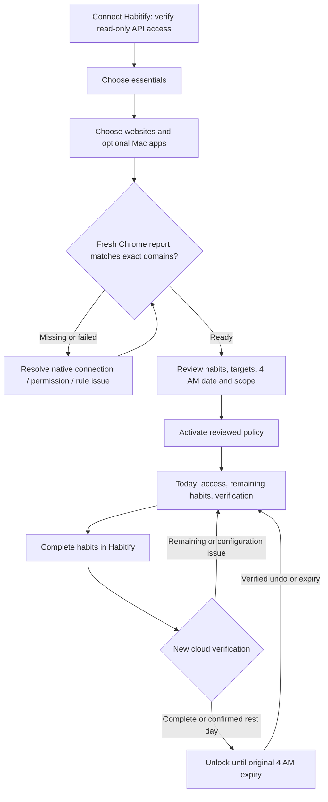
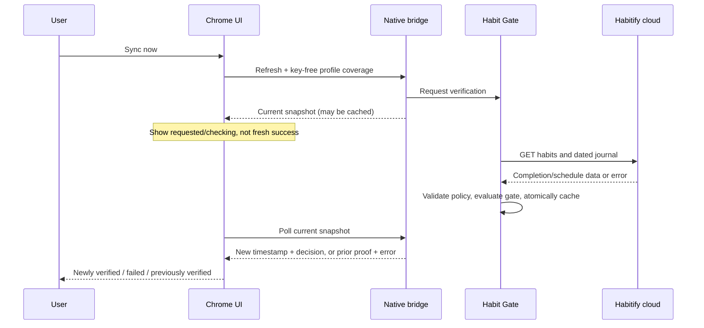

# Habit Gate: UI/UX and reliability implementation review

**Review date:** 18 October 2026

**Installed baseline:** macOS 1.4.0 (10), Chrome 1.1.1

**Decision:** suitable for continued private testing; public release is not approved by this review.

**Presentation follow-up:** the user subsequently requested a simpler full-screen page with random quotes and selected **03 · Midnight Blue**. The installed page uses a centered navy/periwinkle design, one primary action, a compact utility row and a View details dialog. Current screenshots and validation are in `design/midnight-blue/` and `validation/midnight-blue-ui.json`. The PDF addendum predates this visual follow-up; the behavior, rule timing and recovery requirements below remain applicable.

This addendum addresses the user-supplied *Habit Gate — UI/UX, Business Rules & User Flow Improvement Requirements*. It preserves the existing native design and lightweight architecture. The separate 32-page engineering review describes the earlier 1.3.0 (8) baseline and remains historical. Use this addendum for current behavior and evidence.

## Executive assessment

The main usability issue was uncertainty: whether access was locked, whether a sync was fresh, whether a saved change was active, and whether a configured target was actually protected. The update gives those concepts separate status and recovery paths. It also fixes policy recovery and native/browser proof consistency without adding a daemon, external dependency, bypass or Habitify editing.

The installed update preserved the saved policy: seven active essentials, eight scheduled essentials, six domains and five Mac apps. Launch at login remains on. Habitify verified the active date successfully. Messenger redirected to the blocked page in live Chrome, while an unrelated HTTPS page remained usable. Chrome's fresh 1.1.1 report confirms all configured domains have permission and rules are installed; private windows are not enabled.

## Product contract and precedence

The requirements document describes all later changes as scheduled. The user's newer, explicit timing decision takes precedence:

| Edit | Effective time | Consequence |
|---|---|---|
| Initial reviewed setup | On activation | All setup choices are reviewed together |
| Essential habit additions/removals | Next local 4 AM | Today's commitment cannot be reduced through settings |
| Website/app additions | On save | Additional distractions join today's existing gate |
| Website/app removals | Next local 4 AM | Removing a target cannot pause today's protection |
| Mixed target edit | Add now; remove at next 4 AM | A just-added target also cannot be removed immediately |

Chrome normally receives target changes within its 30-second native-state cycle; new custom domains require permission. “On save” describes policy activation, not zero-latency browser propagation. Valid same-day completion proof survives target-only edits. Pending habit edits never activate as a side effect of a target save.

Complete every selected, supported essential scheduled for the active habit date. Only `completed` counts; partial, skipped, failed, missing and unknown states do not. A confirmed rest day may unlock. Missing, archived or unsupported selected habits remain a configuration problem. Before 4 AM, query the previous Gregorian calendar date in the Mac's local timezone. Habitify's own date boundary remains midnight.

## Requirements traceability

“Implemented” describes code and controlled validation. It does not imply every live release scenario has passed.

| ID | Implementation and evidence | Status / remaining work |
|---|---|---|
| UI-01 | Overview separates access, remaining essentials, Habitify verification and Chrome/app coverage. One progress visualization and contextual actions. | Implemented; onboarding comprehension needs a pilot |
| UI-02 | Named active essentials and scheduled selections, exact effective date, selected-first rows, supported-goal explanation and setup draft. | Implemented; long-content fixtures reviewed |
| UI-03 | Per detected profile: version, native response, missing domains, installed rules, private mode, live-test result; immediate domain validation. | Private-alpha implementation; store installation remains open |
| UI-04 | Watching vs verified window hiding, per-app errors, session-preserving foreground wording and addition/removal timing. | Implemented; all five real apps need the current-build live matrix |
| UI-05 | Habitify prerequisites, Disconnect/Reconnect/Delete API key, contextual 4 AM copy, focused Preferences. | Implemented; deletion tested with fake vault, not the live credential |
| UI-06 | Today for quick status; Overview for detail; blocked surfaces for next action; compact popup for connection/access. | Implemented; full VoiceOver/focus audit pending |
| RULE-01 | Explicit active habit date and next 4 AM; Gregorian calendar and shared date/expiry checks. | Controlled boundary/DST/timezone tests pass; live transition tests pending |
| RULE-02 | Active/scheduled summaries and confirmation; setup draft; immediate target additions/deferred removals. | Implemented with explicit user override above |
| RULE-03 | All scheduled essentials completed; explicit rest/configuration states; contradictory unlock proof rejected. | Native and browser proof fixtures agree |
| RULE-04 | Requested/checking/new verification/failure/previous proof; a cached reply is not success. | Implemented; feedback and concurrency regressions pass |
| RULE-05 | Reported profile readiness and private-mode scope; watching vs actual hide; voluntary enforcement copy. | Implemented; no whole-Mac coverage claim |
| RULE-06 | Validated policy, last-good copy, explicit restore, failed-write handling, credential/network/unsupported-habit recovery. | Controlled corruption/write-failure tests pass; physical disk-full trial pending |
| FLOW-01 | Connect → essentials → websites/optional apps → fresh coverage check → review/activate → Today. | Private-alpha flow implemented; live redirect test follows activation |
| FLOW-02 | Launch at login → Today → Habitify → verified sync → unlock. | Implemented; live completion/undo cycle pending |
| FLOW-03 | Primary Open Habitify; accurate Sync; safe Back fallback; origin-only destination and revalidated Continue. | Controlled navigation tests and live Messenger redirect pass |
| FLOW-04 | Notice identifies hidden app and preserved session; Return to Work; Continue only with valid proof. | Implemented; guard tests pass; full current-build app pilot pending |
| FLOW-05 | Errors identify cause, effect and next relevant step; recovery does not silently create a new policy. | Implemented; independent recovery usability testing pending |

## Setup and daily flows

The preactivation check proves a recent native connection, exact domain permissions and successful rule setup. It does not demonstrate a real blocked navigation before activation. The extension's **Test protection** command opens a selected website only while the activated policy is locked. A pass is recorded only after an actual redirect to the blocked page. Our separate live Messenger test is external evidence; it does not populate that in-extension test badge.

## State and recovery specification

| Condition | Access | Feedback and next action |
|---|---|---|
| Scheduled essential is incomplete | Locked | Remaining habits; Open Habitify |
| All due essentials completed | Allowed until proof expiry | Continue; show active date/reset |
| Valid selected habits, confirmed none due | Allowed until proof expiry | Verified rest day |
| Network/server/key failure without valid complete proof | Locked | Show last success/error; Retry or Connection |
| Network/server failure with valid complete proof | Prior unlock until original expiry | Previously verified; no fresh-success claim |
| Successful verification shows undo | Locked | Remaining habits refreshed |
| Missing/unsupported selected habit | Locked | Review essentials; correction follows habit timing |
| Unreadable/deleted policy with recovery evidence | Locked using known/recovered targets | Review and explicitly restore; preserve damaged file |
| Primary policy save fails | Existing active rules retained | Rules not saved; fix space/write access and retry |
| Primary saved; recovery-copy refresh fails | Saved policy remains committed | Recovery-copy warning; no false rollback claim |
| Snapshot cannot persist | Native locked; bridge checks writable storage | Explain storage failure and coverage uncertainty |
| Chrome absent/stale/missing permission | Habit decision unchanged; coverage warning | Open correct profile and resolve extension issue |
| macOS refuses a hide request | Habit decision unchanged; guard warning | Show affected app; do not claim verified hiding |
| Intentional disconnect | Locked, policy retained | Reconnect; optional confirmed key deletion |

Recovery is a controlled configuration repair, not a pause button. No general bypass, forced termination or habit-write API was added. The owner-only backup improves recoverability; it is not a security boundary against the same Mac user. A browser that has already cached complete proof can retain it until the next bridge read or original expiry if native storage becomes unavailable; no instantaneous cross-process revocation guarantee is made.

## Engineering changes and rationale

- `GateCore/ConfigurationRepository.swift`: validates current/backup policies, differentiates first install from damaged state, overlays current targets, compares active habit identities, and rejects stale or contradictory proof. The primary commit and backup result are reported separately.
- `GateStore.swift`: setup drafts and review-gated activation; runtime corruption detection; no in-memory commit after a failed policy save; explicit sync state and recovery actions; injected storage/vault for isolated tests.
- `Credentials.swift`: asynchronous credential session, disconnect invalidation, deletion of only this app's Keychain item. Browser code never receives the key.
- `PolicySummaryView.swift`, `Views.swift`, `MacAppsView.swift`: clear responsibilities, named pending rules, profile diagnostics, verified guard wording and simpler Preferences within the existing visual system.
- `background.js`: domain-specific coverage after policy changes, failed-rule retries, explicit refresh not swallowed by an in-flight read, postactivation redirect test, and setup remaining unactivated until reviewed.
- `permissions.js`: explicit HTTP/HTTPS patterns, missing domains only, direct click-time request and classified recovery messages.
- `feedback.js` / `page.js`: newer verification timestamp required for fresh success; safe Continue/Back behavior; compact popup.
- Redirect destinations retain origin only, without path/query/fragment or embedded credentials.

The architecture remains one native menu-bar process, a short-lived native messaging helper and a Chrome MV3 worker. Habitify checks remain every 60 seconds while awake; Chrome reads local state every 30 seconds; the existing five-second housekeeping interval is retained. No package dependency, fast polling loop, machine learning or additional browser was introduced.

The app-owned cached snapshot now includes app names/bundle identifiers for policy recovery. That metadata is present in native bridge responses; Chrome uses domains for enforcement. Minimizing bridge metadata further is a future privacy-hardening opportunity, not an API-key leak. The API key stays in Keychain, and no journal writes are made.

## Screenshots and visual evidence

Installed screens use the real local policy. Setup screens use an in-memory fixture labelled illustrative, without credentials, network or persisted selections.

| Screenshot | Evidence |
|---|---|
| [Overview](../design/ux-review/installed-overview.png) | Access, remaining count, separate coverage and verification |
| [Essentials](../design/ux-review/installed-habits.png) | Active vs scheduled names and selection |
| [Websites](../design/ux-review/installed-websites.png) | Fresh 1.1.1 report, permissions/rules ready, private mode off |
| [Mac apps](../design/ux-review/installed-apps.png) | Watching vs hide verified; no inflated enforcement claim |
| [Connection](../design/ux-review/installed-connection.png) | Keychain status and disconnect/delete controls; empty key field |
| [Preferences](../design/ux-review/installed-preferences.png) | Launch at login on, notification off |
| [Review setup fixture](../design/ux-review/setup-review-illustrative.png) | Review summary before activation; illustrative |

## Verification and limits

**81 automated tests pass: 61 Swift and 20 browser tests.** Native and browser suites evaluate the same 12 proof fixtures. Coverage includes completion/rest/unknown cases, date and DST boundaries, immediate target additions/deferred removals, missing/duplicate journal entries, failed writes, corruption recovery, reconnect races, permission requests, retrying failed script setup, and truthful refresh feedback. Controlled tests use isolated roots and fake vaults; they do not alter real Habitify progress.

The release build and installed checks pass: ad-hoc signature, fixed extension ID, owner-only native-host registration, framing, unauthorized-origin rejection, oversized-message rejection, and a key-free snapshot contract. Installed extension assets match the source byte-for-byte. The active/pending policy is semantically unchanged from the preinstall backup, a recovery copy exists, and real Habitify synchronization succeeded.

Live browser evidence after repair: `https://www.messenger.com/` becomes `chrome-extension://gggclbgihkhajpchlbeakabkoaaelpdb/blocked.html?target=https://www.messenger.com`; the unrelated `https://example.org/` page remains usable. The stale registration initially reported 1.1.0 and missing Messenger permission despite 1.1.1 files on disk. After the user removed/reloaded the unpacked extension, the fresh report shows 1.1.1, no missing domains and installed rules. Earlier 1.0.0-era live tests of other social domains are historical evidence, not a full new-build rerun.

A pattern scan of 50 app-owned source/runtime files found no Habitify-key-shaped value. Keychain and Chrome profile storage were not read. This is a scoped scan, not a complete privacy/security audit. No live key deletion, destructive storage test or Habitify completion/undo was performed.

No 1.4.0 resource profile was taken. Older CPU/RSS/physical-footprint observations remain historical. Neither the original 100 MB combined memory target nor a current-build CPU guarantee is established by this update.

Machine-readable results: [validation/ux-reliability-update.json](../validation/ux-reliability-update.json). Build/test logs are retained in the workspace `work/` directory and are not needed for normal operation.

## Public-release gates and review decisions

| Priority | Gate | Required evidence / owner role |
|---|---|---|
| P0 | Signed/notarized Mac distribution and Chrome Store update path | Release engineering: install/update/recover on a clean account without Developer mode |
| P0 | Live end-to-end acceptance | Engineering/QA: completion → unlock → undo → relock, 4 AM, midnight date entry, wake/timezone, redirects and already-open tabs |
| P0 | Supported-device persistence faults | Engineering/QA: controlled full-disk/unwritable storage/restart cases with native/browser agreement |
| P1 | Accessibility | Design/QA: keyboard order, focus visibility, VoiceOver, contrast, long names, light/dark and narrow browser states |
| P1 | Independent pilot | Product: users explain access, active/pending rules, scope and recovery without developer assistance |
| P1 | Resource budget | Engineering: repeatable warm idle and helper measurements on current build; declare RSS/footprint accounting |
| P1 | Privacy review | Engineering: minimize bridge metadata, document retention/export/deletion and inspect browser artifacts under a controlled test account |

Recommended CEO decision: continue a small private pilot, retain the current feature scope, and assign release/QA owners before a community launch. Keep Safari, pause/bypass, rewards, analytics and AI features deferred. The next investment should prove the daily block/verify/unlock/relock loop and a simple installation experience.
