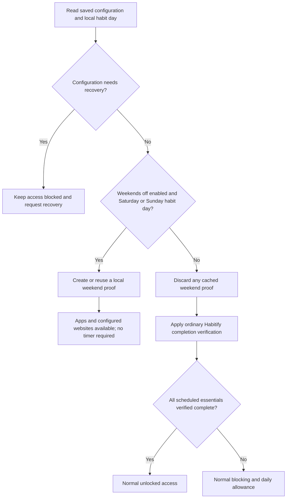
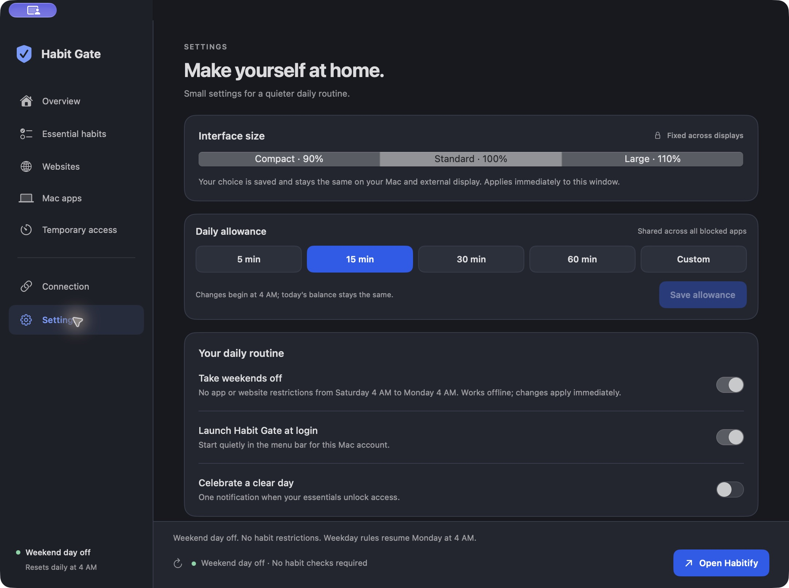
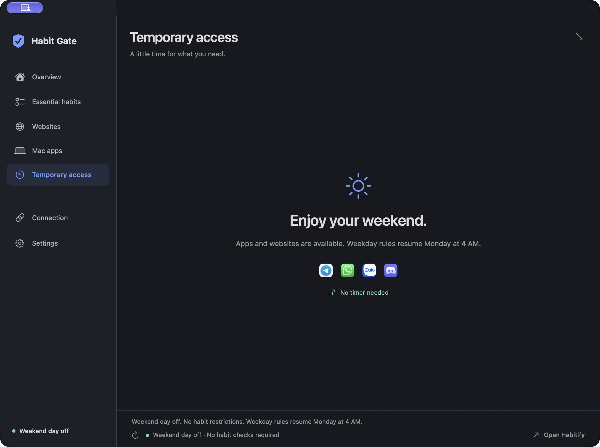

# Weekends off — native 1.6.0

## User behavior

**Take weekends off** is a switch in Settings → Your daily routine. Enabling it makes selected Mac apps and configured websites available throughout the Saturday and Sunday habit days. The switch saves immediately. It is optional and defaults off when an older configuration is loaded.

The feature follows the existing 4 AM local reset:

| Local time | Rule |
|---|---|
| Saturday, 00:00–03:59 | Friday's habits still apply |
| Saturday, 04:00 | Weekend access starts |
| Sunday, including its 4 AM reset | Weekend access continues |
| Monday, 00:00–03:59 | Sunday's time off continues |
| Monday, 04:00 | Normal weekday verification and enforcement resume |

There is no temporary-access countdown during the break. “Enjoy your weekend” and “No timer needed” replace it, and the daily-limit chip is hidden. The daily allowance is neither spent nor replenished by this setting; its ordinary 4 AM reset remains in force. If a countdown is already active when a day off starts, normal unrestricted access ends the temporary session and accounts for its elapsed time.

The feature changes Habit Gate's local access schedule. It never edits Habitify habits, check-ins, occurrence schedules, or completion statuses. Existing essential habits, blocked targets, pending changes, interface size and launch-at-login preference are preserved.

## Decision flow

## Implementation and compatibility

- `Configuration.weekendsOff` is optional. A missing value preserves prior behavior; enabling it does not activate pending habit or target edits.
- `WeekendSchedule` uses `HabitDay` and a Gregorian calendar in the local timezone. It returns a proof only for configured Saturday/Sunday habit days. Proofs expire at the next 4 AM boundary; Sunday's proof cannot authorize Monday at 4 AM.
- `ConfigurationRepository` resolves the schedule for native startup and the Chrome bridge. Configuration recovery takes precedence. Turning the switch off discards a cached weekend unlock before normal verification resumes.
- The native store evaluates the same rule on its existing housekeeping tick and before applying API results or errors. A network outage cannot revoke a valid local day off. Normal read-only API syncing can continue for catalog updates; its success or failure does not determine weekend access.
- Native app rules and Chrome's existing declarative allow rules consume the normal allowed snapshot. Chrome extension 1.1.1 needs no change, reload or additional website permission. The live installed native response was validated with the installed extension's policy code; recent Chrome reports also showed rules ready and website permissions granted.
- The wire format remains version 1. `verificationSource: "weekendSchedule"` identifies a local policy decision. Existing browser adapters use the legacy `lastSyncedAt` field as the proof timestamp; for this source it records local schedule verification, not a fabricated API sync. `lastHabitifySyncedAt` preserves the real latest Habitify sync, when known. Native UI names the state “Weekend day off” rather than presenting it as Habitify completion.
- Selected habit rows use `notDue`, with “Weekend day off” detail. They are never marked completed. The normal weekday evaluator still rejects missing, archived and unsupported selected habits.
- Current local proofs are reused between state changes. No new timer, polling loop, permission or service is added. Existing API retries, local storage checks and browser polling remain in place.

## Validation and limits

99 Swift tests and 20 browser tests passed. Added coverage checks Saturday/Monday 03:59 → 04:00, Sunday renewal, offline operation without an API proof or habit catalog, backward-compatible configuration loading, setting persistence, preserved allowance and selections, disabled schedules, configuration corruption, timezone invalidation and native/browser proof parity.

Installed checks confirmed the setting enabled, local weekend access allowed, weekday selections preserved, daily usage and limits preserved, the bridge response accepted by the installed Chrome 1.1.1 validator, and proof rejection at expiry. Screenshots show the actual installed app. No new performance benchmark or complete accessibility audit is claimed. Physical clock or timezone settings were not changed on the user's Mac; boundary behavior was tested with controlled dates.

## Rollback

The previous 1.5.5 app and private runtime files are backed up outside the repository. To return to that release, stop Habit Gate and restore the backed-up app, configuration/recovery copy and snapshot together. Retain the current daily-access ledger to avoid refunding used time. Restoring only the earlier app could leave its cached weekend proof available until expiry, so restore the previous snapshot as part of rollback. No Habitify data requires restoration.
